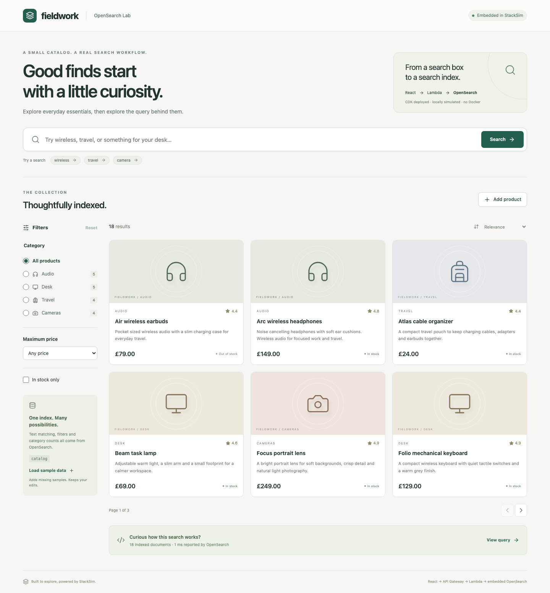
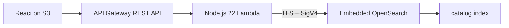

# Fieldwork · OpenSearch Lab

A React product catalog that makes StackSim's embedded OpenSearch useful and visible. Search 18 fictional products, combine filters, inspect the actual query, then add, edit or delete documents and see the search results change.

This follows the other CDK React showcases: an application stack, an S3 website stack, a deployment manifest, and checks against the deployed application. It needs no Docker or external search engine.



[Mobile preview](screenshots/mobile.png)

## Run it

Use Node.js **22.13 or newer**. In the repository root, start StackSim in one terminal:

```sh
npm ci
npm run dev
```

In another terminal:

```sh
cd examples/cdk-opensearch-search-lab
npm ci
npm run deploy
```

Open the website URL printed at the end. Deployment builds the Lambda bundle, synthesizes and verifies the CDK assembly, deploys the application, loads missing samples, rebuilds React with the real API identity, deploys the site, and smoke tests the result. StackSim supplies the local CDK bootstrap; no separate bootstrap command is needed.

Run `npm run deploy` again after changing code. Existing sample documents and edits are preserved. This example uses fixed stack names, so one deployment is supported per account/Region.

| Setting | Default |
| --- | --- |
| `AWS_ENDPOINT_URL` | `http://127.0.0.1:4566` |
| `STACKSIM_INVOKE_ENDPOINT` | `http://127.0.0.1:4567` |
| `AWS_REGION` / `AWS_DEFAULT_REGION` | `eu-west-1` |
| `CDK_DEFAULT_ACCOUNT` / `STACKSIM_ACCOUNT_ID` | `000000000000` |
| `AWS_ACCESS_KEY_ID` / `AWS_SECRET_ACCESS_KEY` | Local `admin` / `password` |

Set these in your shell or IDE environment if StackSim uses different ports, a different account or different local credentials. Use the same settings for deploy, seed, smoke, browser tests and destroy. Deployment and teardown require a healthy loopback StackSim endpoint and do not target AWS. Keep StackSim running while using the site.

## Try the demo

1. Search **wireless**. The `multi_match` query searches the title and description, boosting title matches.
2. Choose **Audio**, **Up to £100**, and **In stock only**. The sample catalog narrows to **Pebble portable speaker**.
3. Open **View query**. Switch between the request DSL and the real OpenSearch response. Category counts use a `terms` aggregation; the selected category uses `post_filter`, so the other categories remain available.
4. Reset the filters, sort by price, and move between result pages. Each page contains up to six documents with an ID tie-breaker for stable ordering.
5. Select **Add product**, or click a product card to edit it. Saves and deletes use `refresh: true`, so the next search reflects the change.
6. Use **Load sample data** to add missing samples. Stable IDs and bulk `create` operations preserve edits and custom products. A deleted sample is restored when samples are loaded again.

There are no inert cart, checkout, cloud scaling or cluster-management controls. The displayed times and counts come from the embedded engine. This is a learning catalog, not a production storefront.

## What CDK deploys



| Stack | Resources |
| --- | --- |
| `SearchLabApplicationStack` | OpenSearch 2.19 domain profile, Lambda and scoped execution role, CloudWatch log group, REST API and CORS methods |
| `SearchLabWebStack` | Public S3 website bucket, CDK asset deployment and automatic bucket cleanup |

The Lambda uses the official `@opensearch-project/opensearch` client and its execution role's temporary credentials. Its OpenSearch IAM policy is scoped to the `catalog` index. The deployment script obtains StackSim's public CA certificate and includes it in the Lambda environment; certificate verification remains enabled. No AWS credentials or CA configuration are shipped to the browser. The local REST API deliberately has no sign-in, matching the small developer demo scope.

The API sets `cloudWatchRole: false`, so it does not claim the shared regional API Gateway logging-role singleton. The search domain is a single embedded node; its CDK capacity settings are a supported local profile, not provisioned cloud capacity.

## Code to explore

| File | Responsibility |
| --- | --- |
| [app.ts](app.ts) | Ordinary CDK constructs and IAM permissions |
| [lambda/api.mjs](lambda/api.mjs) | Validation, query construction, bulk seeding and document writes |
| [lambda/catalog.mjs](lambda/catalog.mjs) | Sample documents and field mappings |
| [lambda/index.mjs](lambda/index.mjs) | Official client, TLS and request signing |
| [frontend/src/App.jsx](frontend/src/App.jsx) | Search, facets, pagination, editor and query inspector |
| [scripts/deploy.mjs](scripts/deploy.mjs) | Two-stage build and deployment |
| [scripts/smoke.mjs](scripts/smoke.mjs) | Deployed API and direct OpenSearch verification |

The API exposes `GET /search`, `POST /seed`, `POST /products`, `PUT /products/{id}`, and `DELETE /products/{id}`. Search parameters are `q`, `category`, `maxPrice`, `inStock`, `sort` and `page`. See `searchInput` for the small, validated contract. Document edits update existing documents and return 404 if another client deleted them.

Runtime URLs and resource names are saved in `.runtime/deployment.json`. Build outputs, the public CA and deployment files are ignored by Git. OpenSearch documents persist in the running StackSim data directory, not in the React bundle.

## Checks and cleanup

```sh
npm run build
npm test
npm run smoke
npx playwright install chromium
npm run test:e2e
```

`build` works without a running server; `smoke` and browser tests require deployment. The smoke check creates, updates and deletes its own temporary product, verifies it through a separately signed OpenSearch client, and checks the hosted assets. Browser checks exercise desktop and mobile search, facets, sorting, pagination, query inspection, CRUD and error recovery. Run browser checks against the unmodified sample catalog; they expect its known products and prices. Screenshots and failure traces are written under `test-results/`.

```sh
npm run seed
npm run destroy
```

`seed` only adds missing samples. `destroy` deletes this demo's two stacks, including its catalog, Lambda, API and website bucket/objects. It uses the synthesized assembly and checks the deployment target first. Shared CDK bootstrap resources remain available to other demos. Keep `.runtime/` and `cdk.out/` until teardown completes.

The demo intentionally stays within the [developer simulator scope](../../docs/opensearch/implementation-plan.md): common text queries and filters, basic aggregations and ordinary document operations. It does not demonstrate distributed search, native Lucene ranking, vector/AI search, production security, high availability or cloud infrastructure sizing.
